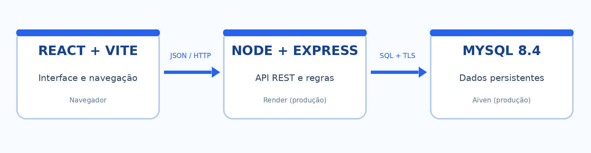

# Identificação do projeto

**Instituição:** Universidade de Fortaleza (Unifor)  
**Curso:** Ciência da Computação  
**Disciplina:** Desenvolvimento Web — Trabalho Final  
**Projeto:** FitManager — Sistema Web de Gestão de Academia e Acompanhamento de Treinos  
**Natureza do documento:** relatório retrospectivo da versão final, derivado do Plano de Trabalho da Etapa 1 (setembro de 2026).  
**Aplicação publicada:** https://fitmanager-final.onrender.com/login  
**Código-fonte:** https://github.com/MarcosG66/fit-manager

| Integrante | Matrícula | Função prevista no plano |
|---|---|---|
| Cairo Forte Ferreira Filho | 2510249 | Desenvolvedor Front-end |
| Henrique José Barbosa Vitalino Carneiro Mello | 2510394 | Desenvolvedor Back-end |
| Marcos Gentili Oliveira | 2513867 | Designer UX/UI |
| Valter Expedito Ribeiro da Silva | 2510404 | Gerente de Projeto |

*As funções correspondem à distribuição de responsabilidades definida no plano original. O relatório descreve entregas do produto e não atribui autoria exclusiva de cada alteração de código a um integrante.*

# Resumo

O FitManager é um sistema web criado para organizar o acompanhamento de alunos, instrutores e gestores de academias em uma única plataforma. Seu desenvolvimento partiu do problema do uso de fichas impressas e planilhas isoladas, que dificultam a atualização de treinos e a consulta ao histórico do aluno. A solução final reúne cadastro e autenticação para três perfis, associação entre aluno e instrutor por código, gerenciamento de alunos e exercícios, criação de fichas, registro de cargas e conclusão diária, avaliação corporal com cálculo de IMC, gráficos de evolução e administração de contas. A implementação utiliza React, Vite e Bootstrap na interface; Node.js e Express na API REST; e MySQL para persistência. O código foi versionado no GitHub, a aplicação está hospedada no Render e o banco MySQL está na Aiven. A verificação do MVP e da versão final incluiu build da interface, auditoria estática, testes unitários e um teste E2E integrado com MySQL. Uma atualização adicional introduziu uma página de tutorial para os três perfis; essa alteração ainda precisa ser enviada ao repositório e implantada para aparecer no site público. O documento apresenta a evolução do plano, a solução concretizada, suas evidências e as limitações da versão acadêmica.

**Palavras-chave:** desenvolvimento web; React; API REST; Express; MySQL; gerenciamento de treinos; software acadêmico.

# 1. Introdução e justificativa

O Plano de Trabalho inicial definiu como problema central o uso de fichas de treino em papel ou planilhas dispersas, sujeitas a desencontros de informação entre aluno e instrutor. O FitManager foi concebido para centralizar a prescrição de exercícios, o registro de cargas e o acompanhamento de métricas corporais, privilegiando a consulta em smartphone no contexto da academia.

Na entrega final, a proposta foi convertida em uma aplicação web de três camadas com autenticação, persistência em banco relacional e implantação acessível por HTTPS. A interface foi estruturada para os diferentes papéis: aluno, instrutor e administrador. O desenvolvimento também incorporou funcionalidades que não estavam explicitadas no planejamento inicial, como recuperação de senha, vínculo por código e gerenciamento da própria conta.

Este documento substitui o caráter prospectivo do Plano de Trabalho por uma **descrição técnica do produto entregue**: os requisitos deixam de ser apenas intenções, e passam a ser relacionados aos componentes, rotas e tabelas que os implementam.

# 2. Objetivos

## 2.1 Objetivo geral

Desenvolver e disponibilizar uma plataforma web responsiva que permita gerenciar alunos, exercícios e fichas de treinamento, registrando resultados e oferecendo histórico de evolução física de forma segura e centralizada.

## 2.2 Objetivos específicos

- Permitir cadastro e autenticação de alunos, instrutores e administradores, com permissões distintas.
- Disponibilizar operações de consulta, inclusão, atualização e exclusão/arquivamento nos recursos pertinentes.
- Permitir ao instrutor criar e administrar fichas com exercícios, séries, repetições e descansos.
- Facilitar a consulta de treinos e o registro de cargas e conclusão diária pelos alunos.
- Armazenar avaliações físicas e calcular o índice de massa corporal (IMC).
- Exibir a evolução das cargas por exercício e período.
- Manter os dados em MySQL, acessado somente pelo servidor da aplicação.
- Oferecer uma experiência responsiva para computadores e smartphones.
- Publicar a aplicação e documentar seus procedimentos de instalação, teste e utilização.

# 3. Evolução do trabalho: do planejamento à versão final

O trabalho foi organizado em três momentos, coerentes com o cronograma do documento original:

| Etapa | Foco no planejamento | Resultado documentado |
|---|---|---|
| Etapa 1 — Planejamento | Definição do escopo, perfis, RF/RNF, protótipo, MER e arquitetura | Plano de Trabalho com três perfis, dez requisitos funcionais, cinco não funcionais, casos de uso e nove entidades de domínio. |
| Etapa 2 — MVP | Interface responsiva, CRUD e integração inicial com MySQL | Base React + Express + MySQL organizada em componentes, páginas, serviços e rotas, com fluxos principais implementados e testados localmente. |
| Etapa 3 — Versão final | Autenticação, autorização, filtros, gráficos, integração completa e publicação | Cadastro dos três perfis, segurança por papéis, vínculo por código, histórico, gráficos, administração, testes, scripts de banco e hospedagem Render/Aiven. |
| Atualização de usabilidade | Melhoria posterior solicitada para orientar o uso | Página pública `/tutorial`, com guias de aluno, instrutor e administrador; incluída no código anexado a este relatório, pendente de novo deploy. |

O protótipo inicial estabelecia identidade visual azul, cartões arredondados, navegação desktop por menu lateral e visão mobile do aluno. A implementação preservou essas diretrizes e consolidou páginas de autenticação, painéis, componentes reutilizáveis e feedback de carregamento/erro. Uma alteração relevante em relação ao protótipo foi a **remoção da escolha de perfil no login**: o servidor identifica o papel do usuário e direciona a interface automaticamente.

# 4. Organização da equipe e metodologia

A divisão original de responsabilidades orientou a execução: Cairo concentrou a função de desenvolvimento front-end; Henrique, a estrutura da API e a integração de dados; Marcos, a interface e a experiência do usuário; Valter, o planejamento, integração e documentação. Em uma aplicação de pequeno porte, as áreas se conectam e exigem coordenação, especialmente para fazer os formulários React coincidirem com os contratos JSON da API.

O processo de desenvolvimento foi incremental. O produto evoluiu de telas e casos de uso para integração de CRUD, adição de autenticação, refinamento de regras de negócio, migrações do banco e publicação. O controle de versão foi realizado com Git/GitHub, e o ambiente local utiliza Docker Compose para executar MySQL e Mailpit. O deploy emprega o repositório do GitHub como origem do código.

As verificações foram organizadas em três níveis: auditoria estática e testes unitários, compilação do cliente com Vite e teste E2E da API com MySQL. A avaliação funcional manual complementa esses testes, especialmente em responsividade, navegação, formulários e experiência de uso.

# 5. Descrição dos perfis e funcionalidades

## 5.1 Aluno

O aluno cria uma conta, pode informar um código de vínculo no cadastro ou associar-se a um instrutor posteriormente e recebe um painel com foco em dispositivos móveis. A área **Treino** apresenta as fichas e os exercícios, séries, repetições, descanso, campos de carga e progresso do dia. Em **Métricas**, registra peso e altura e consulta o IMC e as avaliações anteriores. Em **Evolução**, seleciona um exercício para visualizar a maior carga registrada em cada semana. Também dispõe de **Meu Instrutor** e **Minha Conta**.

## 5.2 Instrutor

O instrutor cria sua conta e recebe um código exclusivo de vínculo de 12 caracteres. A área **Meus Alunos** inclui busca, filtro por status, cadastro, edição e gerenciamento dos alunos associados. Em **Criar / Gerenciar Treinos**, monta fichas por aluno, nome, dia da semana e itens com séries, repetições e descanso. O catálogo de exercícios pode ser consultado e gerenciado nos locais autorizados. O arquivamento de ficha descontinua seu uso sem apagar o histórico de cargas associado.

## 5.3 Administrador

O cadastro administrativo exige um código de convite privado configurado no servidor. Uma vez autenticado, o administrador consulta indicadores e listas de usuários, busca registros, filtra por perfil, ativa/desativa contas e gerencia o catálogo. Há proteções de autorização também na API: ocultar uma opção no React não constitui, por si só, uma restrição de acesso válida.

## 5.4 Recursos comuns

Os três perfis utilizam autenticação por e-mail e senha, encerramento de sessão, consulta/edição dos próprios dados e alteração de senha. O fluxo de recuperação utiliza códigos numéricos de oito dígitos com expiração e limite de tentativas; a entrega efetiva do e-mail depende da configuração do serviço de envio na hospedagem.

# 6. Rastreabilidade dos requisitos funcionais

A tabela relaciona os requisitos RF01–RF10 do plano original à implementação efetiva. O termo **implementado** refere-se à presença das funcionalidades no projeto, não a uma homologação comercial.

| Código | Requisito do plano | Implementação e evidência principal |
|---|---|---|
| RF01 | Cadastro/gestão de usuários e alunos | Cadastro dos três perfis; gerenciamento de alunos, pesquisa, filtro, status e exclusão. `routes/alunos.js`, `ListaAlunos.jsx`, `FormAluno.jsx`. |
| RF02 | Login seguro e direcionamento por papel | `routes/auth.js`, `middleware/auth.js`, `AuthContext.jsx`, `App.jsx`; redirecionamento por perfil proveniente do servidor. |
| RF03 | CRUD de fichas | Criação, consulta, edição e arquivamento de fichas e gestão dos itens. `routes/fichas.js`, `GestaoTreinos.jsx`, `FormFicha.jsx`. |
| RF04 | Catálogo por grupo muscular | Grupos e exercícios em MySQL. `routes/catalogo.js`, `CatalogoExercicios.jsx`. |
| RF05 | Consulta de treino e registro de cargas | `TreinosAluno.jsx`, `CardExercicio.jsx`, `routes/cargas.js`. |
| RF06 | Conclusão e progresso diário | Registro por data, contagem de concluídos e barra de progresso. `conclusao_exercicio`, `TreinosAluno.jsx`. |
| RF07 | Peso, altura e IMC | Registro e histórico de avaliações. `routes/avaliacoes.js`, `MetricasAluno.jsx`. |
| RF08 | Gráficos de evolução | Dados agrupados por semana e gráfico com Recharts. `EvolucaoAluno.jsx`, `routes/cargas.js`. |
| RF09 | Consulta e indicadores administrativos | Indicadores por perfil, busca e controle de contas. `AdminDashboard.jsx`, `routes/usuarios.js`. |
| RF10 | Encerramento de sessão | Logout da API e limpeza do estado da sessão. `routes/auth.js`, `AuthContext.jsx`. |

**Nuance sobre a exclusão:** para fichas de treino, a operação de remoção lógica é executada por arquivamento para preservar dados históricos. Já a exclusão permanente de um aluno pode desencadear exclusões em cascata conforme o esquema. A distinção foi explicitada na interface.

# 7. Rastreabilidade dos requisitos não funcionais

| Código | Requisito | Solução aplicada |
|---|---|---|
| RNF01 | Layout responsivo | Bootstrap 5, CSS responsivo, menus e navegação adaptados a telas móveis; painel do aluno com foco em smartphone. |
| RNF02 | Hash de senhas | `bcryptjs` no servidor; a coluna `usuario.senha_hash` armazena o hash, não a senha original. |
| RNF03 | Comunicação em JSON | Cliente consome `/api` com `fetch`; Express valida o corpo JSON e se comunica com MySQL via `mysql2`. |
| RNF04 | Interface intuitiva | Cards de exercício, navegação organizada, feedback de erros e carregamento, formulários e página de tutorial. |
| RNF05 | Permissões por perfil | Middleware de autenticação, autorização por papel e verificação de propriedade/associação de dados nas rotas. |

# 8. Interface e navegação

A interface utiliza **React** com **React Router** para gerenciar rotas. `App.jsx` define páginas públicas (login, cadastro e recuperação de senha), páginas protegidas por perfil e a nova rota pública de tutorial. `AuthContext.jsx` mantém o estado da sessão, enquanto componentes especializados são reutilizados entre páginas. O backend continua responsável pelas permissões: as rotas protegidas no cliente orientam a navegação, mas não substituem a checagem no Express.

O aluno navega por abas de treino, métricas, evolução, instrutor e conta. Instrutores e administradores utilizam menu lateral responsivo, com seções associadas a suas tarefas. A interface foi baseada no protótipo da Etapa 1, com ajustes introduzidos durante o uso e os testes.

## 8.1 Nova página de tutorial

A versão de código que acompanha este relatório adiciona a **rota `/tutorial`**, acessível mesmo sem autenticação. A página apresenta seis passos específicos para cada um dos três perfis, dúvidas frequentes e links para login ou painel. Os links de ajuda foram adicionados ao layout de autenticação, ao menu/cabeçalho de instrutor e administrador e ao cabeçalho do aluno. A navegação por guias utiliza estado React; não foi necessária uma alteração no banco nem uma nova rota de API.

O tutorial foi implementado como uma melhoria de usabilidade posterior ao plano original. **Seu uso na URL pública depende de publicar o novo commit no GitHub e concluir um novo deploy do Render**; a aplicação publicada anteriormente não deve ser confundida com esta revisão ainda não implantada.

# 9. Arquitetura e tecnologias empregadas



| Camada | Tecnologias | Responsabilidade |
|---|---|---|
| Apresentação | React 19, JavaScript/JSX, Bootstrap 5, CSS, Vite 6 e React Router | Páginas, formulários, navegação, renderização e consumo da API. |
| Aplicação | Node.js 22 e Express 4 | API REST, validação de dados, autenticação, regras de negócio e autorização. |
| Persistência | MySQL 8.4 com `mysql2` | Consultas SQL parametrizadas, transações e relacionamentos por chaves estrangeiras. |
| Segurança | bcryptjs, JWT, cookies `httpOnly`, Zod, Helmet, express-rate-limit | Autenticação e mitigação básica de riscos; controles aplicados no servidor. |
| Desenvolvimento | Docker Compose, Mailpit | Execução local do banco MySQL e recepção de e-mails de teste. |
| Nuvem | GitHub, Render e Aiven | Versionamento, implantação do site/API e hospedagem do banco relacional. |

No ambiente de desenvolvimento, o Vite executa o React na porta 5173 e a API Express utiliza a porta 3001. O Docker executa MySQL na porta local 3307 e Mailpit para captura de mensagens de teste. Em produção, o Express disponibiliza os arquivos estáticos gerados pelo build Vite e os endpoints `/api` no **mesmo domínio HTTPS**. O navegador não recebe as credenciais do banco e não executa comandos SQL diretamente.

## 9.1 Fluxo de uma operação

O registro de carga exemplifica a separação de responsabilidades: (1) o aluno abre um exercício no React; (2) o componente envia uma requisição HTTP/JSON; (3) o Express verifica a sessão e se o exercício pertence ao aluno; (4) a rota valida a carga e grava a informação no MySQL; (5) a resposta atualiza a interface; (6) a consulta de evolução utiliza os registros persistidos para produzir os dados do gráfico.

## 9.2 Organização do código

- `client/src/pages`: páginas e dashboards dos três perfis, incluindo `TutorialPage.jsx`.
- `client/src/components`: peças de interface e componentes especializados de aluno/instrutor.
- `client/src/contexts/AuthContext.jsx`: dados de sessão e ações de autenticação.
- `client/src/services/api.js`: comunicação HTTP com a API.
- `server/src/routes`: operações de autenticação, usuários, alunos, fichas, catálogo, cargas, avaliações e vínculos.
- `server/src/middleware`: autenticação e restrições por perfil.
- `server/src/config/db.js`: conexão MySQL e apoio a transações.
- `server/sql/schema.sql`: esquema relacional; `server/scripts`: criação, migração, seed e testes E2E.
- `render.yaml` e `Dockerfile`: configuração da implantação.

# 10. Banco de dados relacional

O Modelo Entidade-Relacionamento da Etapa 1 possuía **nove entidades de domínio**. A versão final mantém essas entidades e acrescenta duas tabelas técnicas, totalizando **11 tabelas** em MySQL:

| Tabela | Finalidade |
|---|---|
| `usuario` | Identificação, credenciais com hash, perfil, status e controle de versão da sessão. |
| `instrutor` | Vínculo do perfil instrutor com usuário e código de associação. |
| `aluno` | Especialização do usuário, objetivo, plano, status e instrutor opcional. |
| `grupo_muscular` | Classificação do catálogo. |
| `exercicio` | Exercícios cadastrados e suas descrições. |
| `ficha_treino` | Treinos atribuídos a alunos, dia de execução e data de arquivamento. |
| `item_ficha` | Exercícios incluídos na ficha, séries, repetições, descanso, ordem e remoção lógica. |
| `avaliacao_fisica` | Peso, altura e data das avaliações. |
| `historico_carga` | Cargas registradas pelo aluno ao longo do tempo. |
| `conclusao_exercicio` | Conclusão de exercícios por dia, separada do histórico de cargas. |
| `redefinicao_senha` | Códigos de redefinição protegidos por hash, validade e tentativas. |

As entidades são relacionadas por chaves primárias e estrangeiras, com regras de integridade referencial. O IMC é derivado de peso e altura, evitando o armazenamento redundante de um resultado calculável. A inclusão de `conclusao_exercicio` separa o conceito de **realizar um exercício** do ato de **registrar uma carga**. A inclusão de `redefinicao_senha` permite armazenar com segurança o fluxo de recuperação.

A criação do esquema é realizada por `npm run db:init`, que aplica `server/sql/schema.sql` e as migrações. Para instalações locais com Docker, `docker compose up -d --wait` inicia o banco; no ambiente publicado, o MySQL é administrado na Aiven e a conexão é configurada por variáveis de ambiente e TLS.

# 11. API, segurança e decisões de implementação

O backend organiza operações por recurso em uma API REST com `GET`, `POST`, `PUT`, `PATCH` e `DELETE`, conforme a funcionalidade. Os dados trocados com o React são JSON. Rotas de fichas, alunos e avaliações validam parâmetros e aplicam critérios de autorização por papel e por propriedade dos dados.

| Recurso | Objetivo |
|---|---|
| `/api/auth` | Cadastro, login, logout, recuperação e alteração de senha, consulta da sessão. |
| `/api/alunos` | Listagem, pesquisa, criação, atualização, status e exclusão de alunos. |
| `/api/fichas` | Gestão de fichas e seus itens, incluindo arquivamento. |
| `/api/exercicios`, `/api/grupos` | Catálogo e agrupamento muscular (conforme as rotas de catálogo). |
| `/api/cargas` | Registro e consulta de histórico/evolução de cargas e conclusão. |
| `/api/avaliacoes` | Registros físicos e histórico de avaliação do aluno. |
| `/api/usuarios` | Administração de usuários e indicadores. |
| `/api/vinculos` | Código do instrutor e associação entre aluno/instrutor. |
| `/api/health` | Verificação de disponibilidade da API e do banco. |

A autenticação utiliza bcrypt para proteger senhas em repouso e JWT armazenado em cookie `httpOnly`. O servidor valida sessões e permissões antes de aceitar operações protegidas. O fluxo de recuperação envia um código de oito dígitos com expiração, limitação de tentativas e armazenamento do código protegido por hash. O cadastro de administrador depende de convite configurado somente no servidor; o tutorial não revela o segredo.

As dependências foram auditadas após a identificação de alertas de segurança em Nodemailer e Zod, com atualização e nova verificação de vulnerabilidades conhecidas. Foram utilizados mecanismos de limitação de requisições para autenticação e cabeçalhos de segurança do Helmet. Essas medidas são compatíveis com a finalidade acadêmica, mas **não garantem ausência de falhas ou conformidade automática com requisitos de produção comercial**.

# 12. Testes, verificação e evidências

Os seguintes resultados foram registrados durante o desenvolvimento e a implantação da versão base:

| Verificação | Resultado conhecido | Evidência/limite |
|---|---|---|
| Auditoria de dependências do servidor | `npm audit --prefix server`: 0 vulnerabilidades conhecidas no teste informado | Resultado dependente das versões instaladas e da base de advisories naquele momento. |
| Auditoria estática e unitários (versão auditada) | 12/12 testes aprovados | Cobertura de funções e contratos selecionados, não de todas as telas. |
| Compilação do cliente | Build Vite concluído; 490 módulos transformados | Aviso de tamanho do chunk JavaScript, sem impedir o build. |
| Conexão MySQL local | MySQL 8.4.13, 11 tabelas detectadas | Executado com o banco Docker. |
| Integração E2E local | Aprovada | Cadastro, login inválido, vínculo, ficha, cargas, arquivamento, histórico e permissões. |
| Conexão com Aiven | MySQL 8.4.11, 11 tabelas; `/api/health` retornou `ok:true, db:true` | Confirma conexão da API local com banco remoto. |
| Publicação do FitManager | Site acessível no Render, informado como funcional após a implantação | Endereço público disponibilizado pela equipe. |
| Atualização do tutorial (pacote atual) | 13/13 testes unitários/contratos aprovados nesta revisão | Verificação estrutural adicional; build e teste em navegador ainda devem ser executados após a integração. |

O teste E2E da versão base exigiu direcionar o host de teste explicitamente para IPv4 (`127.0.0.1`) no Windows para que o Node.js alcançasse a API local. Essa situação não se relacionava a falhas do banco de dados.

**Validação pendente para a nova alteração:** o tutorial foi adicionado depois dos testes completos que precederam a publicação inicial. É necessário executar `npm run build`, conferir `/tutorial` no navegador (incluindo dimensões mobile) e repetir a verificação após o deploy. Não foi executado um novo teste E2E com MySQL por causa dessa alteração apenas de interface.

# 13. Implantação e operação

A versão final utiliza GitHub como repositório, Render como hospedagem web e Aiven for MySQL para persistência. A aplicação pública está em **https://fitmanager-final.onrender.com/login**. A separação entre hospedagem da aplicação e do banco evita depender do computador do desenvolvedor. As credenciais são armazenadas em variáveis privadas da plataforma; o código-fonte não deve conter senhas nem o convite administrativo.

O serviço Render executa a instalação das dependências, o build do React e o servidor Express, que responde às requisições HTTP e entrega a interface compilada. Na Aiven, o banco `fitmanager` contém as 11 tabelas, utilizadas pela aplicação através do driver MySQL. O endpoint de saúde permite confirmar a disponibilidade da API e sua conexão com o banco.

O plano gratuito do Render pode suspender o serviço após inatividade, gerando demora no primeiro acesso. O serviço de e-mail de recuperação precisa ser configurado separadamente na nuvem para enviar mensagens externas. Para um uso não acadêmico, são necessários processos de backup, monitoramento, gestão de usuários e dados pessoais e revisões adicionais de segurança.

# 14. Limitações e melhorias futuras

O FitManager atende ao escopo da atividade acadêmica, porém foram reconhecidos limites importantes:

- Não há verificação obrigatória do endereço de e-mail na criação da conta.
- O envio real dos códigos de recuperação depende da configuração de provedor de e-mail na hospedagem.
- O convite administrativo é reutilizável enquanto permanecer válido; para produção real, recomenda-se convite individual, expirável e de uso único.
- O limite de requisições por IP usa armazenamento em memória e deveria ser compartilhado em uma implantação com múltiplas instâncias.
- A exclusão permanente de alunos pode excluir dados relacionados em cascata; exige política explícita de retenção antes de uso comercial.
- Faltam evidências de testes de acessibilidade e navegador automatizados cobrindo todas as interações.
- A nova página de tutorial requer novo commit e deploy antes de ficar disponível publicamente.
- Para operação comercial, também seriam necessários backups automatizados, monitoramento, políticas de privacidade e revisão da conformidade com a LGPD.

Como evoluções futuras, recomenda-se a criação de convites por e-mail com expiração, melhoria de notificações, testes de interface com Playwright, otimização do carregamento JavaScript por divisão de bundles e controle de múltiplas academias, se o escopo do produto for ampliado.

# 15. Considerações finais

O projeto atingiu o objetivo do Plano de Trabalho ao evoluir de um conjunto de requisitos, protótipos e modelo de dados para um **sistema web full-stack funcional e implantado**, com experiências distintas para alunos, instrutores e administradores. A aplicação reúne CRUD, navegação, autenticação, regras de negócio, persistência em MySQL, registro de resultados e acompanhamento por gráficos. A existência de scripts de criação e migração do banco e de procedimentos de teste contribui para a reprodutibilidade da entrega.

A experiência de desenvolvimento também evidenciou que o projeto vai além da construção de telas: exige integração consistente entre interface, API, armazenamento, permissões e infraestrutura. A página de tutorial adicionada nesta revisão aprimora a autonomia do usuário e reforça o compromisso com a usabilidade, ainda que precise passar pela validação e publicação da nova versão.

O FitManager constitui, assim, uma demonstração concreta dos fundamentos de desenvolvimento web previstos na disciplina, preservando uma base modular para extensões futuras.

# Apêndice A — Instalação para avaliação local

**Pré-requisitos:** Node.js 22, npm e Docker Desktop (ou MySQL 8.4 configurado manualmente).

```bash
npm run setup
npm install
npm run install:all
docker compose up -d --wait
npm run db:init
npm run db:check
npm run audit
npm run build
npm run dev
```

Abra `http://localhost:5173` para usar a aplicação, `http://localhost:5173/tutorial` para o tutorial e `http://localhost:3001/api/health` para verificar a API. O Mailpit local usa `http://localhost:8025`.

**Testes E2E:** com a API ligada, em outro terminal Git Bash, execute apenas no banco de desenvolvimento:

```bash
TEST_API_ORIGIN=http://127.0.0.1:3001 npm run test:e2e
```

**Atenção:** nunca inclua `server/.env`, `client/.env`, códigos de administrador, senhas do MySQL ou arquivos de backup no repositório público. O teste E2E gera dados e não deve ser executado contra a Aiven de produção.

# Apêndice B — Documentos e materiais de referência

Este relatório foi elaborado a partir do documento *FitManager — Plano de Trabalho (Etapa 1)*, de setembro de 2026 (11 páginas), e do código-fonte `fit-manager-main.zip` fornecido pela equipe. Foram conferidos os requisitos (p. 5), os protótipos (pp. 6–8), o MER (pp. 8–9), a arquitetura e rotas (pp. 9–10) e o cronograma (p. 10). Para detalhes de implantação e validação, consultar `docs/BANCO_MYSQL.md`, `docs/REQUISITOS_FINAIS.md`, `docs/TESTES_FINAIS.md` e `docs/TUTORIAL_DE_USO.md` no projeto.
